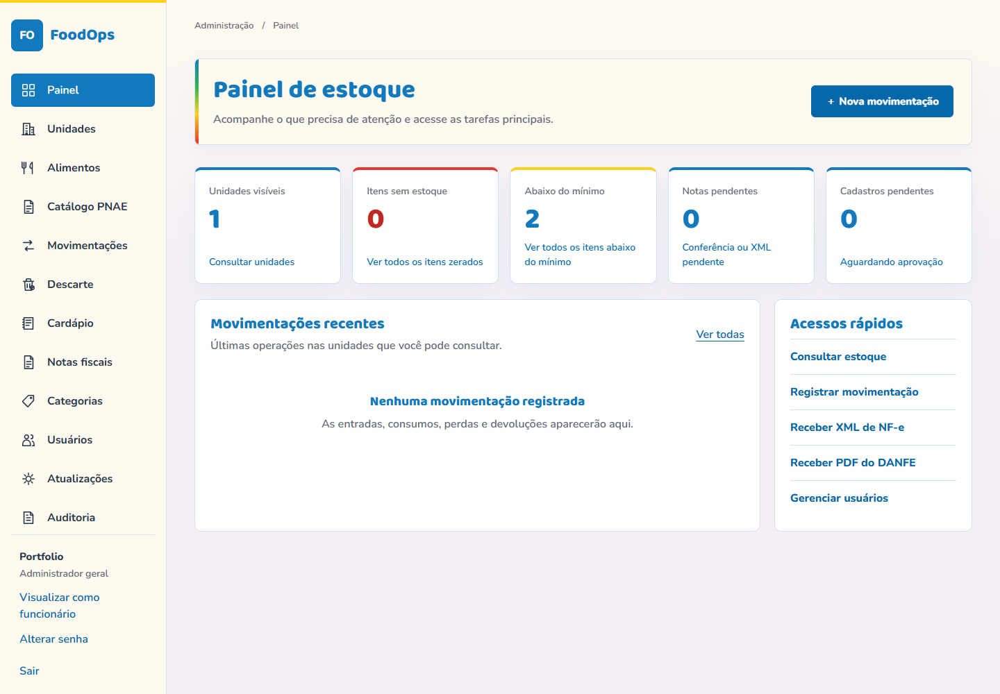
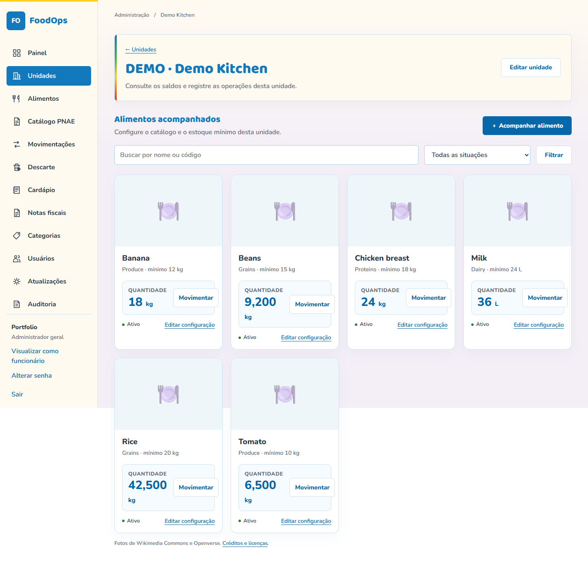
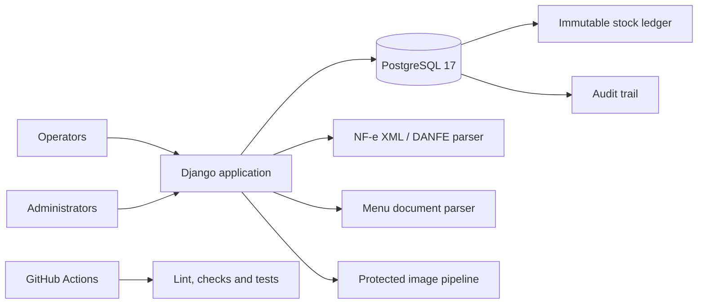

# Food Inventory Operations

[English / README principal](README.md) · Português (Brasil)

[](https://github.com/santosgus3dtech/food-inventory-operations/actions/workflows/checks.yml)
[](https://www.djangoproject.com/)
[](https://www.postgresql.org/)

Uma plataforma de estoque de alimentos e operações para múltiplas unidades, voltada a programas institucionais de alimentação. O sistema
reúne controle de estoque, entrada de notas fiscais, planejamento de cardápios, evidências de descarte, acesso por função e uma
trilha de auditoria imutável em uma aplicação Django responsiva.

A interface é intencionalmente escrita em português brasileiro para os operadores a quem se destina. Este
repositório é uma edição de portfólio sem dados sensíveis: não contém nomes reais de organizações, usuários,
endereços, notas fiscais, credenciais, domínio de produção, banco de dados ou documentos privados.

## Capturas de tela





As capturas de tela foram geradas a partir de um banco de dados local isolado contendo apenas unidades,
alimentos, quantidades e usuários sintéticos.

## Escopo do produto

- Estoque para múltiplas unidades com categorias, alimentos, embalagens e níveis mínimos de estoque.
- Entradas, consumos, perdas, devoluções, ajustes e estornos de estoque atômicos.
- Validação de XML de NF-e, prevenção de duplicatas e associação de itens a alimentos.
- Entrada de PDF de DANFE com controles de acesso e conciliação posterior com o XML.
- Matriz de distribuição para dividir uma nota fiscal entre várias unidades.
- Verificações do catálogo PNAE e fluxo de aprovação para exceções justificadas.
- Histórico de preços normalizado por quilograma, litro ou unidade.
- Planejamento semanal de cardápios a partir de documentos enviados.
- Registros de descarte com evidências fotográficas protegidas.
- Aprovação de usuários, permissões por unidade e modo de visualização prévia para administradores.
- Busca, filtros, paginação e layouts móveis para uso operacional recorrente.
- Registros de auditoria imutáveis da aplicação, sustentados por triggers do PostgreSQL.

## Arquitetura



As alterações de estoque nunca são representadas apenas por um saldo mutável. Cada operação cria um
lançamento no registro de movimentações e atualiza a quantidade atual dentro de uma única transação de banco de dados. Os estornos criam um novo
evento compensatório, preservando o histórico e a responsabilização.

## Destaques de engenharia

- Django 5.2 com modelo de usuário personalizado e limites explícitos entre funções.
- Restrições, bloqueios de linha e triggers do PostgreSQL para a integridade da auditoria.
- Análise defensiva de XML com `defusedxml` e limites rigorosos de upload.
- Eliminação de duplicatas de notas fiscais por chave de acesso e hash do conteúdo.
- Distribuição transacional dos itens de notas fiscais entre unidades.
- Validação de imagens, normalização de EXIF, limites de tamanho e entrega protegida.
- Senhas com Argon2, limitação de tentativas de login, controles de sessão e troca obrigatória de senha.
- Suporte a caminho base para implantação por proxy reverso sob um prefixo de URL.
- Entrega de arquivos estáticos com WhiteNoise e configuração reforçada de contêineres.
- CI para lint, formatação, verificações do Django, detecção de divergências nas migrações e cobertura de testes.

## Tecnologias

`Python 3.13+` · `Django 5.2` · `PostgreSQL 17` · `psycopg` · `Docker Compose` ·
`uv` · `Ruff` · `WhiteNoise` · `Gunicorn` · `defusedxml` · `pypdf` · `pdfplumber`

## Execução local

Requisitos:

- Python 3.13 ou 3.14
- [uv](https://docs.astral.sh/uv/)
- Docker Desktop ou Docker Engine com Compose

```powershell
uv sync --locked
uv run python scripts/configurar_local.py
docker compose up -d --wait
uv run python manage.py migrate
uv run python manage.py preparar_local
uv run python manage.py runserver 127.0.0.1:8000 --noreload
```

Abra <http://127.0.0.1:8000>. O comando de configuração gera segredos locais e uma
credencial temporária de administrador em `.local/`; ambos os locais são ignorados pelo Git.

Nenhum dado de produção ou de clientes está incluído. Crie unidades e alimentos de exemplo pela aplicação
antes de testar os fluxos.

Para um cenário fictício completo com três unidades, cinco alimentos, limites mínimos de estoque e um
histórico auditável de recebimentos e consumos, execute:

```powershell
uv run python manage.py carregar_demo_portfolio
```

Siga [`docs/DEMO_WALKTHROUGH.md`](docs/DEMO_WALKTHROUGH.md) para o fluxo voltado a recrutadores.

## Verificações de qualidade

```powershell
uv run ruff check .
uv run ruff format --check .
uv run python manage.py check
uv run python manage.py makemigrations --check --dry-run
uv run python manage.py collectstatic --noinput
uv run python manage.py test
```

A suíte de testes cobre permissões, invariantes de estoque, estornos, proteção da auditoria, associação de NF-e,
distribuição de notas fiscais, tratamento de imagens, fluxos de cardápio, cadastro e controles de segurança.

## Privacidade e segurança

O sistema operacional privado mantém XMLs de notas fiscais, PDFs, registros de usuários, dados de unidades, fotos enviadas,
credenciais e estado do banco de dados fora do controle de versão. A edição pública segue a mesma regra.

Antes de implantar um fork:

1. crie segredos exclusivos para o banco de dados e o Django;
2. execute com `DJANGO_DEBUG=0`;
3. configure hosts e origens CSRF explícitos;
4. termine a conexão HTTPS em um proxy confiável;
5. isole o PostgreSQL da rede pública;
6. implemente backups externos criptografados e teste a restauração;
7. defina uma política de retenção para documentos fiscais e evidências fotográficas.

Leia [`docs/ARCHITECTURE.md`](docs/ARCHITECTURE.md) e
[`docs/SECURITY.md`](docs/SECURITY.md) para os detalhes do projeto.

## Mapa do repositório

```text
config/       Django settings, URLs and WSGI entry point
core/         Domain models, services, parsers, views and tests
templates/    Responsive server-rendered interface
static/       Styles, scripts, fonts and attributed food images
deploy/       Container image and database initialization
scripts/      Local setup and startup helpers
docs/         Architecture and security notes
```

As imagens de referência de alimentos vêm do Wikimedia Commons e do Openverse. Os detalhes de atribuição e licença
são preservados em `static/foods/credits.json`.

## Licença

Licença MIT. Consulte [`LICENSE`](LICENSE). As licenças de imagens e fontes de terceiros continuam regidas pelos
respectivos arquivos de atribuição.
